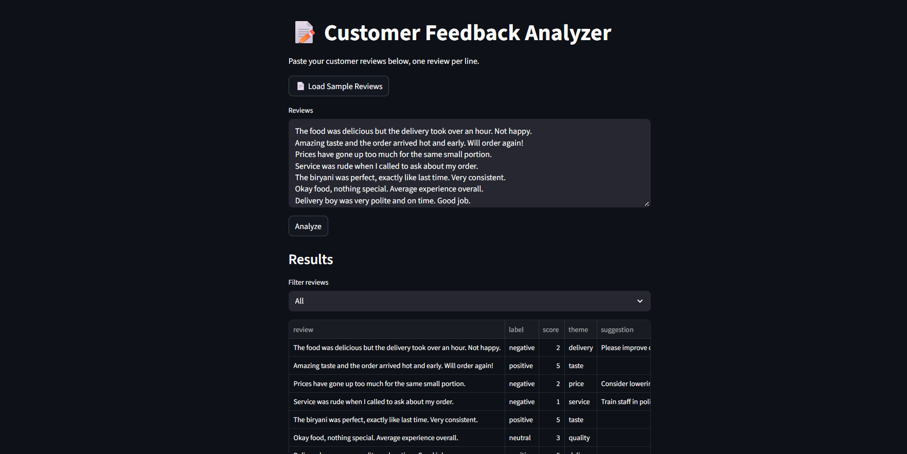
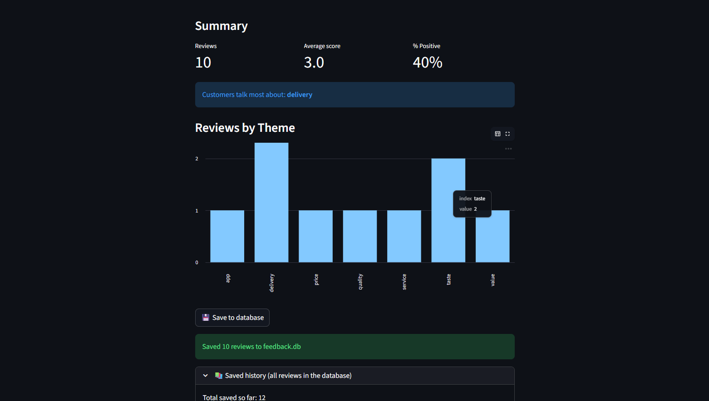
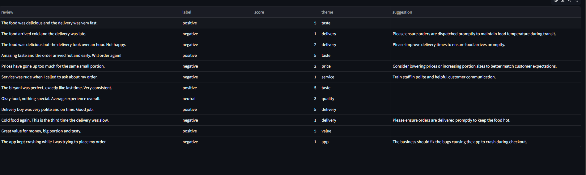

## Customer Feedback Analyzer ##

An end-to-end GenAI application that analyzes customer reviews and provides useful insights for businesses.

The application uses Streamlit for the frontend, FastAPI for the backend, Gemini API for AI-powered analysis, and SQLite for storing review results.

## Features

- Analyze multiple customer reviews at once
- Classify reviews as Positive, Negative, or Neutral
- Give each review a score from 1–5
- Identify the main theme of each review
- Generate a short suggestion for negative reviews
- Filter reviews by sentiment
- Visualize reviews by theme using a bar chart
- Load sample reviews from a text file
- Save analyzed reviews to a SQLite database
- View previously saved review history

## Tech Stack

- Python
- Streamlit – Frontend dashboard
- FastAPI – Backend API
- Google Gemini API – Review analysis
- SQLite – Database
- Requests – API communication

##  How It Works

Customer Reviews
       ↓
Streamlit Frontend
       ↓
FastAPI Backend
       ↓
Gemini API
       ↓
Sentiment + Score + Theme + Suggestion
       ↓
SQLite Database

## Screenshots

### Application Dashboard

### Review Analytics

### Analysis Results

## How to Run

1. Clone the repository

git clone YOUR_GITHUB_REPOSITORY_URL
cd python_feedback_analyzer

2. Install dependencies

uv sync

3. Add your Gemini API key

Create a ".env" file in the project folder:

GEMINI_API_KEY=your_api_key_here

Do not upload your ".env" file or API key to GitHub.

4. Start the FastAPI backend

uv run fastapi dev api.py

5. Start the Streamlit frontend

Open another terminal and run:

uv run streamlit run app.py

Then open the local Streamlit URL shown in the terminal.

## Project Structure

python_feedback_analyzer/
│
├── app.py
├── api.py
├── database.py
├── sample_reviews.txt
├── README.md
├── pyproject.toml
├── .gitignore
│
└── screenshots/
    ├── dashboard.png
    ├── analytics.png
    └── results.png

## What I Learned

This project helped me practice:

- Building a Streamlit application
- Creating and consuming APIs with FastAPI
- Integrating a Generative AI API
- Working with SQLite databases
- Handling API responses and errors
- Processing and analyzing customer feedback
- Creating simple data visualizations
- Connecting frontend, backend, AI, and database components

## Project

Customer Feedback Analyzer
Built with Python, FastAPI, Streamlit, Gemini API, and SQLite.
